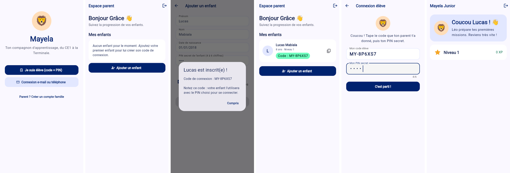

# Mayela

Plateforme intelligente de soutien scolaire, du CE1 à la Terminale.
Premier programme ciblé : République du Congo (architecture multi-pays).

> **État : phase 1 (socle technique) terminée.** Prochaine étape : phase 2, gestion pédagogique.



## Documentation

- [Architecture, schéma de base de données, plan par phases et décisions](docs/ARCHITECTURE.md)
- [Design system (maquettes Stitch)](docs/DESIGN_SYSTEM.md)
- [Maquettes de référence](docs/ui-references/)
- Documentation de l'API : `http://localhost:8000/docs` (générée par Scribe)

## Structure

```
backend/   API REST Laravel 13 + back-office Filament (PHP 8.3, PostgreSQL)
mobile/    Application Flutter 3.50 (Android / iOS)
docs/      Architecture, design system, maquettes
```

## Démarrer en local

### Prérequis
PHP 8.3+, Composer, PostgreSQL 16, Flutter 3.50 et, au choix, Docker pour lancer PostgreSQL, Redis et Mailpit.

### Backend

```bash
docker compose up -d                      # PostgreSQL (+ base de test), Redis, Mailpit
cd backend
composer install
cp .env.example .env && php artisan key:generate
# Renseigner MAYELA_ADMIN_EMAIL et MAYELA_ADMIN_PASSWORD dans .env
php artisan migrate --seed                # rôles, permissions, pays (Congo), premier super-admin
php artisan scribe:generate               # documentation de l'API
php artisan serve                         # http://localhost:8000
```

- Back-office : `http://localhost:8000/admin`. À la première connexion, la double authentification (application TOTP) est exigée.
- Tests : `vendor/bin/pest` (base `mayela_test`) · Style : `vendor/bin/pint`

### Mobile

```bash
cd mobile
flutter pub get
flutter run                                              # émulateur Android → backend sur 10.0.2.2:8000
flutter run --dart-define=API_BASE_URL=http://<IP>:8000/api/v1   # téléphone réel sur le même réseau
flutter test && flutter analyze
```

## Ce que fait la phase 1

| Fonction | Où |
|---|---|
| Inscription parent (e-mail ou téléphone), connexion, déconnexion par appareil | API + app |
| Ajout d'un enfant par le parent : code élève `MY-XXXXXX` + PIN, consentement parental horodaté | API + app |
| Connexion enfant par code + PIN (limitée contre la force brute) | API + app |
| Inscription autonome des élèves de 15 ans et plus | API (écran prévu avec l'onboarding, phase 3) |
| 6 rôles et permissions (élève, parent, super-admin, admin pédagogique, contributeur, modérateur) | Backend |
| Back-office : gestion des utilisateurs, 2FA obligatoire, journal d'audit | Filament |
| Thème Mayela décliné en 3 univers (Junior / Collège / Lycée) | App |

## Points à connaître

- **IA** : désactivée tant qu'aucun budget n'est alloué (aucune fonction IA simulée dans l'app).
- **Contenus** : aucun programme ni sujet officiel n'est inventé. Les contenus seront importés à partir des cours scannés par l'équipe, puis validés (phase 2).
- **Analyse statique PHP (Larastan)** : non installée, car l'environnement de développement initial ne pouvait pas télécharger PHPStan. À ajouter avec `composer require --dev larastan/larastan`.
- **Conditions d'utilisation et politique de confidentialité** : les textes restent à rédiger avant la mise en production. L'app enregistre l'acceptation et sa version (`MAYELA_CONSENT_VERSION`).
